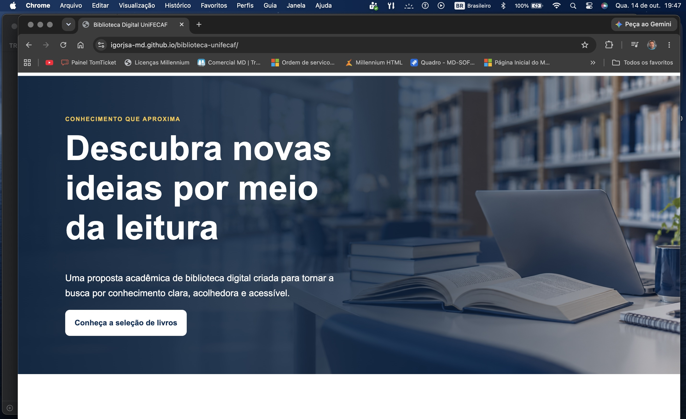

# Relatório — Biblioteca Digital UniFECAF

**Disciplina:** Design Web  
**Aluno:** Igor Jose Santos de Assis  
**Data:** 14 de outubro de 2026

## 1. Introdução e objetivo

Este projeto apresenta uma interface acadêmica para a Biblioteca Digital UniFECAF. O objetivo foi aplicar HTML5 e CSS3 na criação de uma página moderna, responsiva e acessível, mantendo o código legível para estudantes iniciantes. A página não possui backend nem simula empréstimos, autenticação ou consulta a um catálogo ativo.

## 2. Análise do problema

O problema propõe transformar uma estrutura inicial de baixa fidelidade em uma experiência visual consistente. Além de organizar grande quantidade de conteúdo, a solução deve continuar legível em celulares, tablets e computadores. Também é necessário diferenciar conteúdo demonstrativo de informações institucionais reais, evitando dados inventados.

## 3. Análise do protótipo de baixa fidelidade

O protótipo da página 3 apresenta uma página única e vertical. No topo há uma barra de navegação seguida por um banner. Depois aparecem a apresentação da biblioteca, com textos, imagem central e quatro destaques; um segundo banner visual; seis cards de livros em duas fileiras; três blocos de unidades formados por imagem e texto; e uma área final de contato.

Essa hierarquia foi mantida no `index.html`. A implementação reúne os dois momentos visuais do protótipo em um banner principal e reaproveita seu recorte na seção “Sobre”, evitando uma imagem decorativa repetida sem conteúdo. Os seis livros permanecem organizados em duas fileiras de três cards no desktop. As três unidades seguem o formato horizontal de imagem e texto, com alternância visual na segunda faixa. Cores, tipografia, conteúdo e dimensões foram refinados porque o protótipo define estrutura, não acabamento final.

## 4. Público-alvo

O público principal é composto por estudantes universitários que acessam conteúdo acadêmico em computadores e dispositivos móveis. A interface também considera pessoas com baixa visão, mobilidade reduzida ou navegação por teclado por meio de contraste, foco visível, áreas de toque e estrutura semântica.

## 5. Paleta de cores

As cores foram declaradas como variáveis em `:root`:

| Variável | HEX | Uso |
|---|---|---|
| `--azul-900` | `#082F58` | títulos, banner, contato |
| `--azul-800` | `#0B477D` | marca e links |
| `--azul-600` | `#0878BD` | rótulos e destaques |
| `--azul-100` | `#DFF3FF` | estados suaves de interação |
| `--amarelo` | `#F4C542` | foco e detalhe complementar |
| `--branco` | `#FFFFFF` | fundos e texto sobre azul |
| `--cinza-050` | `#F7F9FC` | fundo alternado |
| `--cinza-200` | `#DCE3EA` | bordas |
| `--cinza-600` | `#52606D` | textos secundários |
| `--cinza-900` | `#17212B` | texto principal |

Não havia material oficial de marca disponível no projeto. Foi usada uma aproximação em azul, documentada aqui, sem afirmar reprodução exata da identidade institucional.

## 6. Tipografia

A pilha `Arial, Helvetica, sans-serif` foi escolhida por ser legível, amplamente disponível e dispensar dependências externas. Os títulos usam tamanhos fluidos com `clamp()`, enquanto o corpo mantém `1rem` e entrelinha de `1.65`.

## 7. Decisões visuais

O azul cria unidade e associação com ambiente acadêmico. O amarelo aparece apenas como detalhe para manter equilíbrio e boa identificação do foco. Cards brancos, bordas discretas, sombras suaves e cantos arredondados separam conteúdos sem excesso decorativo. A imagem do banner possui área vazia à esquerda para preservar a leitura do título.

## 8. Seções do site

1. **Cabeçalho:** marca textual e menu com links internos.
2. **Banner:** apresenta objetivo do projeto e conduz à seleção de livros.
3. **Sobre:** explica o caráter demonstrativo e mostra quatro benefícios.
4. **Livros:** reúne seis obras reais em domínio público. Os links levam ao portal Domínio Público, sem criar páginas inexistentes.
5. **Unidades:** usa três blocos conceituais, sem nomes ou endereços inventados.
6. **Contato:** orienta o visitante para o site oficial e informa que não há serviço ativo.
7. **Rodapé:** identifica a atividade acadêmica.

## 9. Estrutura HTML e CSS

O HTML usa `header`, `nav`, `main`, `section`, `article` e `footer`. Cada seção tem título associado por `aria-labelledby`. O CSS fica separado em `css/style.css`, com variáveis, estilos base, componentes e media queries organizados nessa ordem. As imagens locais estão em `assets/imagens/`.

## 10. Responsividade

A base foi escrita para smartphones. A partir de `40rem`, livros passam a duas colunas, benefícios a duas e unidades a três. A partir de `64rem`, livros passam a três colunas, benefícios a quatro e a seção “Sobre” divide imagem e texto. Larguras relativas, `clamp()`, `min()` e imagens com largura máxima impedem estouro horizontal.

Os pontos de conferência indicados são 375 px, 768 px e 1440 px. A validação estrutural confirmou caminhos e arquivos; as capturas visuais finais nesses tamanhos devem ser feitas no navegador antes da entrega.

## 11. Acessibilidade

Foram aplicados idioma `pt-BR`, meta viewport, texto alternativo, hierarquia de títulos, link “Pular para o conteúdo”, foco visível, links descritivos, alvos de toque, contraste e navegação nativa por teclado. Links externos avisam leitores de tela sobre a abertura em nova aba. `prefers-reduced-motion` remove a rolagem suave quando o usuário prefere menos movimento.

## 12. Questão central

Transformar um protótipo de baixa fidelidade em uma interface moderna exige preservar sua hierarquia, mas desenvolver um sistema visual consistente. Neste projeto, isso ocorreu pela definição de variáveis de cor, componentes reutilizáveis, hierarquia tipográfica e grades que mudam conforme o espaço. A identidade aproximada foi aplicada com azul e elementos acadêmicos, enquanto semântica e media queries garantiram acesso em diferentes contextos.

## 13. Considerações finais

O resultado demonstra que HTML e CSS são suficientes para produzir uma página organizada e responsiva. O principal aprendizado foi conciliar aparência, simplicidade do código, fidelidade à estrutura do protótipo e transparência sobre os limites de uma demonstração. Antes da entrega, ainda são necessárias capturas, conversão deste documento em PDF, publicação e gravação do vídeo.

## 14. Referências

- MOZILLA DEVELOPER NETWORK. *HTML: HyperText Markup Language*. Disponível em: <https://developer.mozilla.org/pt-BR/docs/Web/HTML>. Acesso em: [inserir data].
- MOZILLA DEVELOPER NETWORK. *CSS: Cascading Style Sheets*. Disponível em: <https://developer.mozilla.org/pt-BR/docs/Web/CSS>. Acesso em: [inserir data].
- W3C. *Web Content Accessibility Guidelines (WCAG) 2.2*. Disponível em: <https://www.w3.org/TR/WCAG22/>. Acesso em: [inserir data].
- BRASIL. *Portal Domínio Público*. Disponível em: <https://www.dominiopublico.gov.br/>. Acesso em: [inserir data].
- UNIFECAF. *Site oficial*. Disponível em: <https://www.unifecaf.com.br/>. Acesso em: [inserir data].
- UNIFECAF. *Trabalho — Design Web*. Documento da atividade e protótipo de baixa fidelidade, 7 páginas. Material fornecido na disciplina.

## Capturas do projeto

### Versão desktop

**Figura 1 — Página inicial da Biblioteca Digital UniFECAF em versão desktop.**  
Fonte: elaboração própria (2026).

### Versão smartphone

**Figura 2 — Página inicial da Biblioteca Digital UniFECAF em versão mobile.**  
Fonte: elaboração própria (2026).
